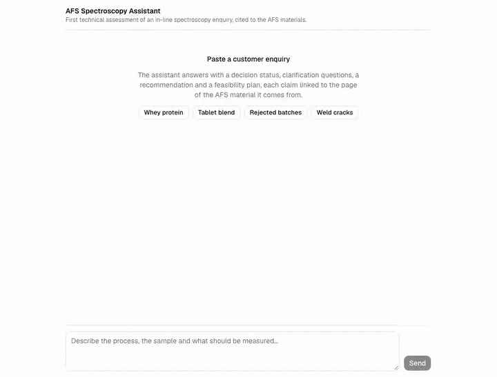
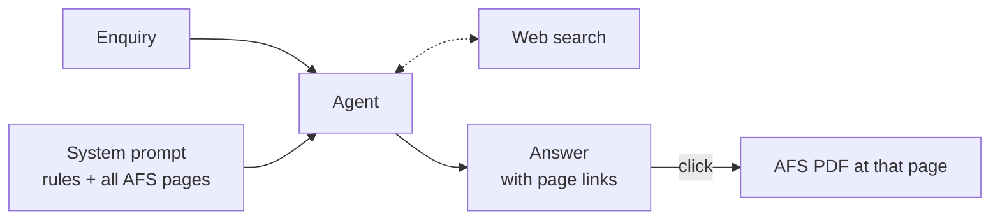

# AFS Spectroscopy Assistant

Reads a customer's in-line spectroscopy enquiry and writes a first technical assessment: decision status, premise check, clarification questions, recommended method and probe concept, risks and a four-stage feasibility plan. Every claim links to the AFS page it comes from.

A prototype built for the SchubKI 2026 hackathon (Art Fiber Systems challenge). Not an official AFS product and not production software.



Live: https://afs-spectroscopy-assistant.vercel.app

## Generated answers

No setup needed to review them. Each was generated once by the assistant and committed unedited:

| Final evaluation | Development |
|---|---|
| [H01](outputs/final/H01.md) · [H02](outputs/final/H02.md) · [H03](outputs/final/H03.md) · [H04](outputs/final/H04.md) · [H05](outputs/final/H05.md) · [H06](outputs/final/H06.md) | [D01](outputs/final/D01.md) · [D02](outputs/final/D02.md) · [D03](outputs/final/D03.md) · [D04](outputs/final/D04.md) · [D05](outputs/final/D05.md) · [D06](outputs/final/D06.md) · [D07](outputs/final/D07.md) · [D08](outputs/final/D08.md) |

Citations like `[S01 p.16]` link to `materials/<file>.pdf#page=16`.

## Quick start

Requires Node 24, pnpm and an [OpenRouter](https://openrouter.ai) API key.

```bash
pnpm install
cp .env.example .env.local   # set OPENROUTER_API_KEY
pnpm dev                     # http://localhost:3000
```

From the command line:

```bash
pnpm cases                   # H01–H06 → outputs/<model>/
pnpm cases D01 T03 --out try # any development or trap enquiries
pnpm check outputs/try       # status line, questions, citation pages
```

The answers in [`outputs/final/`](outputs/final/) were generated this way, unedited. `runs.json` logs model, tokens, cost and time for each.

## How it works



- `pnpm ingest` turns each AFS PDF into page-tagged markdown: the exact text layer plus notes on figures and slides.
- All pages go into a cached system prompt ([`prompts/system.md`](prompts/system.md)) with the assessment rules.
- One agent call answers, using web search only for facts the materials lack.

Details: [docs/architecture.md](docs/architecture.md).

## Repository

```
prompts/        system prompt and reminder
knowledge/      AFS materials as page-tagged markdown
materials/      original AFS files, served for citation links
src/            chat page, API route, agent
scripts/        ingest.ts, cases.ts
evals/          trap enquiries and checks
outputs/final/  generated answers for H01–H06 and D01–D08
```
