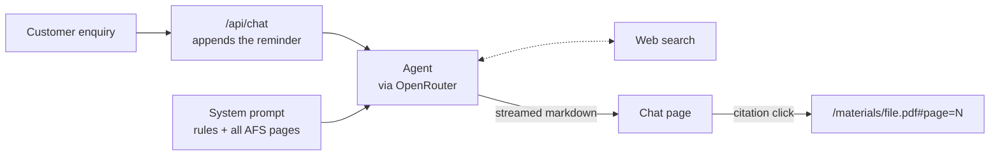
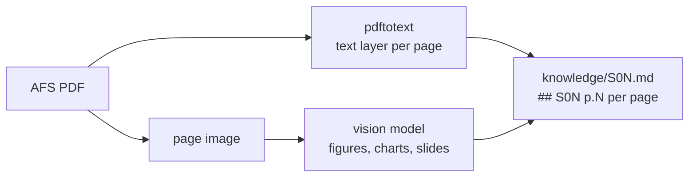

# Architecture

One model call with all AFS materials in its prompt and web search as its only tool.

## Request flow



1. The chat page sends the conversation to `/api/chat` (`src/app/api/chat/route.ts`).
2. The route appends a short reminder of the hard rules to the latest enquiry (`prompts/reminder.md`).
3. The agent (`src/lib/agent.ts`) calls the model once. It sends the system prompt with every AFS page in it, and the conversation.
4. The model may call web search for facts the materials lack.
5. The answer streams back as markdown. Every AFS claim carries a link such as `[S01 p.18](/materials/S01_Multispectral_Laboratory.pdf#page=18)`.
6. The `/materials/[file]` route serves the original PDF, and the browser opens it at that page.

The command-line runner (`scripts/cases.ts`) uses the same agent. It writes `outputs/<name>/<ID>.md` and logs each run in `runs.json`.

## Knowledge: from PDFs to page-tagged text



`pnpm ingest` (`scripts/ingest.ts`) turns each PDF into one markdown file with one heading per page:
- The PDF text layer is copied verbatim, so numbers and units stay exact.
- A vision model describes what the text layer misses: figures, charts and photos. For slides with little text, it writes a full transcription. Its rules: copy only visible values, mark unsure readings with `[?]`, no interpretation.
- Vision notes are cached in `knowledge/vision/`.
- One table (S01 p.6) is scrambled in the PDF text layer. The organisers' spreadsheet copy of it replaces that page.

What is left out, on purpose:
- The reference document contains worked example answers, so it is not used as knowledge; its answer structure is part of the system prompt.
- The evaluation scenarios file is test input only.

At load time (`src/lib/prompt.ts`), each page is wrapped in a tag that carries its id and link target, so the model can cite it exactly:

```
<page id="S01" p="18" href="/materials/S01_Multispectral_Laboratory.pdf#page=18">…</page>
```

## The prompt

`prompts/system.md` is ordered from stable to specific:

| Block | What it does |
|---|---|
| `<role>` | An AFS application spectroscopist writing a first assessment for an expert reviewer |
| `<task>` | Which answer type fits: full assessment, insufficient information, questions only, follow-up, out of scope |
| `<rules>` | Facts, assumptions and sources kept apart; no invented numbers; check the client's premise; respect evidence scope |
| `<domain_checks>` | Five checks on every enquiry: fiber range, probe geometry, signal route, calibration transfer, reference method |
| `<method_overview>` | A one-table summary of the methods, with the pages to read |
| `<citations>`, `<web_search>` | Link format; web facts kept in a separate section with a quote |
| `<answer_format>` | Status line, premise check, fixed short sections, ≤5 questions each with a concrete reason, a 4-stage feasibility plan |
| `<materials>` | All AFS pages; the whole prompt is ~69k tokens |

The prompt is the same for every request, so it is cached.

## Why this design

| Option | Decision | Reason |
|---|---|---|
| Retrieval (RAG) | Not used | All materials fit in one prompt. A premise check needs pages the enquiry doesn't name, for example a fiber's transmission range when the client asks about a probe. Retrieval can miss them. |
| Several agents or a review pass | Not used | One call already catches the trap premises; an extra pass adds latency and cost. |
| JSON output with code checks | Not used | Markdown with links is readable as it streams, and the reader can click every claim. Quality is measured with evaluations at development time instead. |

## How it scales

The page-tagged files and the citation format stay the same at every tier. Only how pages reach the model changes.

| Corpus size | Approach |
|---|---|
| Up to ~200k tokens (now: 5 documents) | Everything in the cached prompt |
| Hundreds to thousands of pages | Ingest also writes a map per document (sections → page ranges with one-line summaries). The prompt holds the maps, and the agent reads pages with a `read_pages(doc, from, to)` tool. |
| Millions of pages | Hybrid search picks candidate pages, then the same `read_pages` tool reads them and their neighbours |

## Evaluation

- `evals/cases/traps.txt`: trap enquiries, each built on a common mistake (wrong probe geometry, unsuitable fiber, no signal route, calibration transfer, demands for numbers, stretched evidence, out of scope, too vague, one sound control).
- `pnpm check <dir>`: word count, status line, premise check, questions, and whether every cited page exists.
